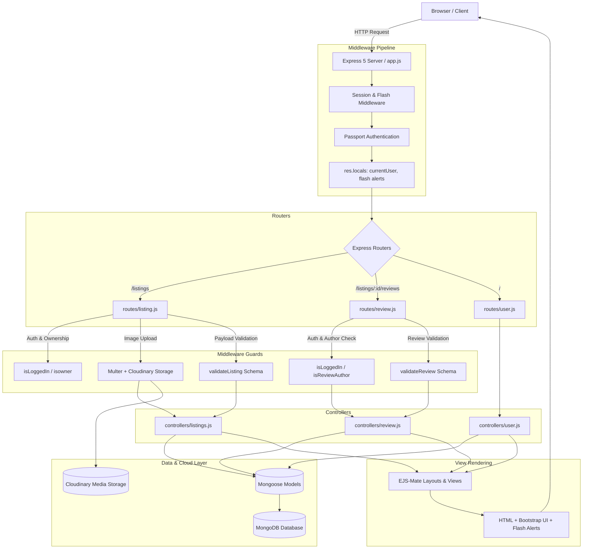
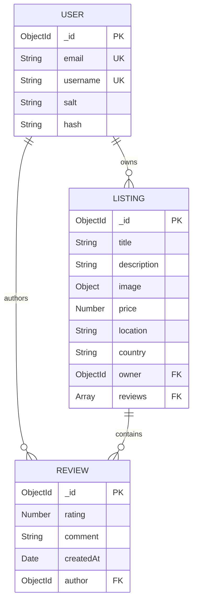

# 🏡 WanderLust — Full-Stack Airbnb Clone

[](https://nodejs.org/)
[](https://expressjs.com/)
[](https://www.mongodb.com/)
[](https://cloudinary.com/)
[](https://www.passportjs.org/)
[](https://getbootstrap.com/)
[](https://opensource.org/licenses/ISC)
[](https://github.com/darshak767/Airbnb)

**WanderLust** is a modern, production-ready, full-stack vacation rental marketplace web application inspired by **Airbnb**. Built with **Node.js**, **Express 5**, **MongoDB**, **Mongoose**, **EJS**, and **Bootstrap 5**, it provides an intuitive platform for exploring travel destinations, publishing accommodations with cloud media uploads, managing listings with strict ownership permissions, and leaving interactive star-rated reviews.

---

## 📑 Table of Contents

- [Overview](#-overview)
- [Key Features](#-key-features)
- [Tech Stack](#-tech-stack)
- [Application Architecture](#-application-architecture)
- [Data Models & Relationships](#-data-models--relationships)
- [API & Route Directory](#-api--route-directory)
- [Folder Structure](#-folder-structure)
- [Getting Started](#-getting-started)
  - [Prerequisites](#prerequisites)
  - [Installation](#installation)
  - [Environment Variables](#environment-variables)
  - [Database Seeding](#database-seeding)
  - [Running the App](#running-the-app)
- [Security, Middleware & Validation](#-security-middleware--validation)
- [Roadmap](#-roadmap)
- [Contributing](#-contributing)
- [License](#-license)

---

## 📌 Overview

WanderLust delivers an end-to-end rental discovery and hosting experience:
- **Guests** can browse destinations worldwide, inspect detailed accommodation pricing, location, descriptions, and user feedback, and submit their own star-rated reviews.
- **Hosts** can list their properties, upload high-resolution images securely hosted via Cloudinary, and update or delete their listings with automated cascading cleanup.
- **Architecture**: The project follows a strict **MVC (Model-View-Controller)** pattern with modular Express routers, dedicated controllers, centralized error handling, Joi schema validation, session-based authentication with Passport.js, and interactive feedback with connect-flash alerts.

---

## ✨ Key Features

| Category | Feature | Status | Description |
|---|---|:---:|---|
| **Authentication** | User Signup & Login | ✅ | Secure registration and credential validation via Passport-Local-Mongoose |
| **Authentication** | Session Persistence | ✅ | Express session cookies with automatic post-login URL redirect |
| **Authentication** | Logout | ✅ | Terminates user session with instant flash feedback |
| **Authorization** | Listing Ownership Guard | ✅ | Only verified listing owners can edit or delete their listings (`isowner`) |
| **Authorization** | Review Author Guard | ✅ | Only review authors can remove their individual reviews (`isReviewAuthor`) |
| **Listings** | Browse All Listings | ✅ | Responsive Bootstrap 5 card gallery displaying prices formatted in INR (`₹`) |
| **Listings** | Listing Details View | ✅ | Rich details including host username, description, pricing, location, country, and reviews |
| **Listings** | Create Accommodation | ✅ | Multipart form with Cloudinary image upload and Joi validation |
| **Listings** | Edit & Update | ✅ | Pre-filled edit form with optional image replacement via Cloudinary |
| **Listings** | Cascading Deletion | ✅ | Deleting a listing triggers a Mongoose hook deleting all linked reviews |
| **Cloud Media** | Cloudinary Image Hosting | ✅ | Uploaded listing photos stored securely in `wanderlust_dev` cloud storage folder |
| **Reviews** | Interactive Star Ratings | ✅ | Starability CSS 1–5 star rating system with written feedback |
| **Reviews** | Delete Review | ✅ | Removes review document and `$pull`s reference ID from parent listing |
| **Flash Alerts** | Dynamic User Alerts | ✅ | Bootstrap dismissible success and error notifications across all actions |
| **Validation** | Server Schema Validation | ✅ | Strict incoming payload verification with Joi schemas (`schema.js`) |
| **Validation** | Client Form Validation | ✅ | Real-time Bootstrap 5 validation states (`needs-validation`) |
| **Error Handling** | Centralized Handler | ✅ | Custom `ExpressError` class and async error propagation via `wrapAsync` wrapper |
| **Search & Map** | Mapbox Geocoding & Search | 🔄 | Geolocation maps and live destination search filters (in progress) |

---

## 🛠️ Tech Stack

### Backend
- **Runtime:** [Node.js](https://nodejs.org/) (v18+)
- **Web Framework:** [Express.js v5](https://expressjs.com/)
- **Database ODM:** [Mongoose v9](https://mongoosejs.com/)
- **Authentication:** [Passport.js](https://www.passportjs.org/) & [passport-local](https://www.passportjs.org/packages/passport-local/)
- **Session & Cookies:** `express-session`, `cookie-parser`, `connect-flash`
- **File Uploads & Cloud Storage:** [Multer](https://github.com/expressjs/multer), [Cloudinary v2](https://cloudinary.com/), `multer-storage-cloudinary`
- **Schema Validation:** [Joi v18](https://joi.dev/)
- **Utilities:** `dotenv`, `method-override` (RESTful PUT/DELETE emulation)

### Frontend
- **Templating Engine:** [EJS](https://ejs.co/) with [EJS-Mate](https://github.com/JacksonTian/ejs-mate) layout boilerplate
- **Styling & Components:** [Bootstrap 5.3](https://getbootstrap.com/)
- **Star Ratings:** [Starability CSS](https://github.com/LunarLogic/starability) rating animations
- **Iconography:** [Font Awesome 6/7](https://fontawesome.com/)
- **Client Scripting:** Modern Vanilla JavaScript (Bootstrap form validation & responsive navbar)

### Database
- **Database:** [MongoDB](https://www.mongodb.com/) (Local Community Server or MongoDB Atlas cloud cluster)

### Developer Tooling
- **Auto-reloading:** [Nodemon](https://nodemon.io/)
- **Version Control:** [Git](https://git-scm.com/) & [GitHub](https://github.com/)

---

## 🧠 Application Architecture

The application adopts the classic **MVC (Model-View-Controller)** pattern with modular routing and defensive middleware pipelines:



---

## 🗃️ Data Models & Relationships

The database architecture is designed with clear document associations:



### 1. User Model (`models/user.js`)
Powered by `passport-local-mongoose` for salted password hashing and username authentication:
- `email`: String (required, unique)
- `username`: String (automatically added by plugin)
- `hash` & `salt`: Strings (managed by plugin)

### 2. Listing Model (`models/listing.js`)
- `title`: String (required)
- `description`: String
- `image`: `{ url: String, filename: String }` (stored on Cloudinary)
- `price`: Number (required, minimum 0)
- `location`: String (required)
- `country`: String (required)
- `owner`: `ObjectId` referencing `User`
- `reviews`: Array of `ObjectId`s referencing `Review`

> **Cascading Delete Post-Hook:**
> When a listing is removed via `findByIdAndDelete()`, the associated post middleware cleans up all referenced reviews:
> ```javascript
> listingSchema.post("findOneAndDelete", async function (doc) {
>   if (doc) {
>     await Review.deleteMany({ _id: { $in: doc.reviews } });
>   }
> });
> ```

### 3. Review Model (`models/review.js`)
- `comment`: String (required)
- `rating`: Number (required, min 0, max 5)
- `createdAt`: Date (defaults to `Date.now`)
- `author`: `ObjectId` referencing `User`

---

## 🌐 API & Route Directory

### 🔐 Authentication & User Endpoints (`/`)

| Method | Endpoint | Description | Middleware & Controller |
|---|---|---|---|
| `GET` | `/signup` | Render signup form | `userController.renderSignupForm` |
| `POST` | `/signup` | Register new user & automatic login | `wrapAsync(userController.signupForm)` |
| `GET` | `/login` | Render login form | `userController.renderLoginForm` |
| `POST` | `/login` | Authenticate credentials & redirect | `saveRedirectUrl`, `passport.authenticate`, `userController.login` |
| `GET` | `/logout` | Terminate session & log out | `userController.logout` |

---

### 🏡 Listing Endpoints (`/listings`)

| Method | Endpoint | Description | Middleware & Controller |
|---|---|---|---|
| `GET` | `/listings` | List all accommodations | `wrapAsync(listingController.index)` |
| `GET` | `/listings/new` | Render create-listing form | `isLoggedIn`, `listingController.renderNewForm` |
| `POST` | `/listings` | Upload image & persist listing | `isLoggedIn`, `upload.single('Listing[image]')`, `validateListing`, `listingController.createListing` |
| `GET` | `/listings/:id` | View listing details, host & reviews | `wrapAsync(listingController.showListing)` |
| `GET` | `/listings/:id/edit` | Render pre-populated edit form | `isLoggedIn`, `wrapAsync(listingController.renderEditForm)` |
| `PUT` | `/listings/:id` | Update listing & optional new image | `isLoggedIn`, `isowner`, `upload.single('Listing[image]')`, `validateListing`, `listingController.updateListing` |
| `DELETE` | `/listings/:id` | Delete listing & cascade delete reviews | `isLoggedIn`, `wrapAsync(listingController.deleteListing)` |

---

### 💬 Review Endpoints (`/listings/:id/reviews`)

| Method | Endpoint | Description | Middleware & Controller |
|---|---|---|---|
| `POST` | `/listings/:id/reviews` | Create & link review to listing | `isLoggedIn`, `validateReview`, `wrapAsync(reviewController.createReview)` |
| `DELETE` | `/listings/:id/reviews/:reviewId` | Delete review & `$pull` from listing | `isLoggedIn`, `isReviewAuthor`, `wrapAsync(reviewController.deleteReview)` |

---

### ℹ️ Auxiliary Endpoints

| Method | Endpoint | Description |
|---|---|---|
| `GET` | `/` | Root health route |
| `GET` | `/privacy` | Privacy policy page |
| `GET` | `/terms` | Terms of service page |

---

## 📂 Folder Structure

```
Air bnb/
├── .env                          # Secret environment variables (Ignored by Git)
├── .gitignore                    # Git ignore file
├── app.js                        # Express server entry point, session & passport setup
├── cloudConfig.js                # Cloudinary & Multer-storage configuration
├── middleware.js                 # Authentication & authorization route guards
├── package.json                  # Project manifest, dependencies & scripts
├── package-lock.json             # Pinned dependency lockfile
├── schema.js                     # Joi validation schemas (listingSchema, reviewSchema)
│
├── controllers/                  # Route controller logic (MVC)
│   ├── listings.js               # Listing business logic & Cloudinary handling
│   ├── review.js                 # Review creation & deletion logic
│   └── user.js                   # Authentication & user registration handlers
│
├── init/                         # Database initialization & seeding scripts
│   ├── data.js                   # Sample accommodations data array
│   └── index.js                  # Database seeder runner script
│
├── models/                       # Mongoose database schemas
│   ├── listing.js                # Listing schema with cascading delete hook
│   ├── review.js                 # Review schema with author reference
│   └── user.js                   # User schema with passport-local-mongoose
│
├── routes/                       # Express modular resource routers
│   ├── listing.js                # Listing RESTful route definitions
│   ├── review.js                 # Review nested route definitions (mergeParams)
│   └── user.js                   # User authentication route definitions
│
├── utils/                        # Utility classes & wrappers
│   ├── ExpressError.js           # Custom ExpressError class
│   └── wrapAsync.js              # Async wrapper for unhandled promise rejections
│
├── views/                        # EJS templates & layouts
│   ├── layouts/
│   │   └── boilerplate.ejs       # Main HTML boilerplate with Bootstrap 5
│   ├── includes/
│   │   ├── flash.ejs             # Dismissible success & error alert banner
│   │   ├── footer.ejs            # Global footer component
│   │   └── navbar.ejs            # Dynamic responsive navigation bar
│   ├── listings/
│   │   ├── edit.ejs              # Edit accommodation form
│   │   ├── index.ejs             # Explore places cards grid
│   │   ├── new.ejs               # Create new accommodation form
│   │   └── show.ejs              # Accommodation details, host, reviews & star rating
│   ├── users/
│   │   ├── login.ejs             # User login form
│   │   └── signup.ejs            # User registration form
│   └── error.ejs                 # Centralized error page view
│
└── public/                       # Static web assets
    ├── css/
    │   ├── rating.css            # Starability star rating styling
    │   └── style.css             # Custom styles & card layout
    ├── js/
    │   └── script.js             # Bootstrap client form validation
    └── img/
        └── albert.jpg            # Local fallback listing image
```

---

## 🚀 Getting Started

### Prerequisites

Ensure you have the following installed on your machine:
- **Node.js** (`v18.0.0` or higher) — [Download Node.js](https://nodejs.org/)
- **npm** (`v9.0.0` or higher)
- **MongoDB** (Local Community Server or a free [MongoDB Atlas](https://www.mongodb.com/atlas) cluster)
- **Cloudinary Account** (Free tier for media uploads) — [Sign Up](https://cloudinary.com/)

Verify installations:
```bash
node -v
npm -v
mongod --version
```

---

### Installation

1. **Clone the repository:**
   ```bash
   git clone https://github.com/darshak767/Airbnb.git
   cd "Airbnb"
   ```

2. **Install dependencies:**
   ```bash
   npm install
   ```

---

### Environment Variables

Create a `.env` file in the root directory and populate it with your credentials:

```env
# MongoDB Connection String
mongo_URL=mongodb://127.0.0.1:27017/wanderlust

# Cloudinary Storage Configuration
CLOUD_NAME=your_cloudinary_cloud_name
CLOUD_API_KEY=your_cloudinary_api_key
CLOUD_API_SECRATE=your_cloudinary_api_secret

# Mapbox Geocoding Token (Optional / In Development)
MAP_TOKAN=your_mapbox_token_here
```

> [!WARNING]
> Never commit your `.env` file or API credentials to GitHub or public version control. Keep `.env` included in `.gitignore`.

---

### Database Seeding

To seed your MongoDB database with sample accommodation listings:

```bash
node init/index.js
```

> [!IMPORTANT]
> The seed script drops the existing `Listing` collection before inserting sample data. Do not execute this against production databases with active user data.

---

### Running the App

- **Development Mode (with Nodemon hot-reload):**
  ```bash
  npm run dev
  ```

- **Production Mode:**
  ```bash
  npm start
  ```

Once running, navigate your web browser to:
```
http://localhost:8000/listings
```

---

## 🛡️ Security, Middleware & Validation

### 1. Route Guards & Authorization (`middleware.js`)
- **`isLoggedIn`**: Ensures the user is authenticated via `req.isAuthenticated()`. If unauthenticated, saves the current requested URL to `req.session.redirectUrl` so users return to their intended destination upon login.
- **`saveRedirectUrl`**: Passes the preserved URL from `req.session` to `res.locals` so Passport redirect hooks can read it after authentication.
- **`isowner`**: Queries the listing by ID and verifies that `listing.owner.equals(req.user._id)`. Unauthorized users receive an error flash alert and are redirected.
- **`isReviewAuthor`**: Protects review deletion, ensuring only `review.author.equals(req.user._id)` can trigger deletion.

### 2. Schema Validation with Joi (`schema.js`)
Incoming request bodies are validated before touching database models:
- **`listingSchema`**: Ensures `title`, `description`, `price` (min 0), `location`, and `country` satisfy data types and presence rules.
- **`reviewSchema`**: Ensures `rating` is an integer between `0` and `5`, and `comment` has a minimum length of 3 characters.

### 3. Asynchronous Error Management (`utils/wrapAsync.js`)
Catches any rejected promise in asynchronous Express handlers and automatically forwards it to `next(err)`:
```javascript
module.exports = (fn) => {
  return (req, res, next) => {
    fn(req, res, next).catch(next);
  };
};
```

---

## 🗺️ Roadmap

- [x] Full CRUD operations for listings
- [x] Cloudinary cloud media storage for listing images
- [x] Review creation and deletion with star ratings (Starability CSS)
- [x] Mongoose cascading delete middleware for orphaned reviews
- [x] User authentication with Passport.js (Signup, Login, Logout)
- [x] Route authorization guards (`isLoggedIn`, `isowner`, `isReviewAuthor`)
- [x] Session management & connect-flash notifications
- [x] Server-side Joi validation & client-side Bootstrap form feedback
- [x] Modular MVC architecture with controllers and routers
- [ ] Mapbox interactive maps and geocoding on listing show pages
- [ ] Category-based listing filters (Beach, Mountain, Castles, Camping, Iconic Cities)
- [ ] Live search bar by title, country, or location
- [ ] User profile dashboard with hosted properties & reviews
- [ ] Booking & date reservation system
- [ ] Automated integration test suite (Jest & Supertest)

---

## 🤝 Contributing

Contributions, issues, and feature suggestions are welcome! Please check out the [Contributing Guidelines](CONTRIBUTING.md) before submitting a Pull Request.

1. Fork the Project
2. Create your Feature Branch (`git checkout -b feature/AmazingFeature`)
3. Commit your Changes (`git commit -m "feat(listings): add some amazing feature"`)
4. Push to the Branch (`git push origin feature/AmazingFeature`)
5. Open a Pull Request

For full details on local environment setup, database seeding, coding standards, and PR requirements, see [CONTRIBUTING.md](CONTRIBUTING.md).


---

## 📄 License

This project is licensed under the **ISC License**.

---

<div align="center">
  <sub>Built with ❤️ by <a href="https://github.com/darshak767">Darshak</a></sub>
</div>